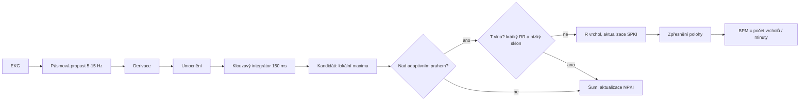
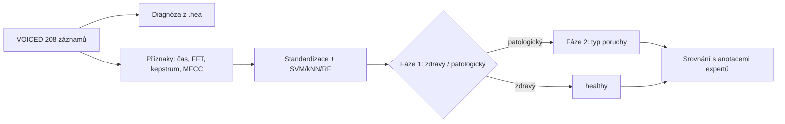

# KI/PZS – seminární práce I a II

Autoři: *(doplňte jména studentů)*

## Instalace

```bash
pip install -r requirements.txt
```

## Spuštění

Data se standardně streamují přímo z PhysioNetu (potřeba internet). Volitelně je lze stáhnout
(`python download.py drivedb voiced nsrdb`) a skripty pak spouštět s `--data-dir data`.

| Úloha | Příkaz | Výstupy |
|---|---|---|
| I/1 Tepová frekvence | `python sem1_task1_heart_rate.py` | `outputs/sem1_task1/` |
| I/2 Korelace signálů | `python sem1_task2_correlation.py` | `outputs/sem1_task2/` |
| II Klasifikace hlasu | `python sem2_voiced_classification.py` | `outputs/sem2/` |

Užitečné přepínače: `--nsrdb-minutes` (délka testovaného úseku nsrdb, výchozí 30), `--fs` (společná
vzorkovací frekvence v úloze I/2), `--reuse` (u práce II znovu nepočítat příznaky).

Offline test funkčnosti na syntetických datech: `python make_synthetic_data.py` a pak spustit skripty
s `--data-dir synthetic` (viz hlavička souboru). Výsledky na syntetice nejsou pro práci použitelné.

## Struktura

| Soubor | Obsah |
|---|---|
| `physio.py` | čtení dat přes WFDB (jediné místo, kde se WFDB používá) |
| `dsp.py` | vlastní DSP: filtry, FFT spektrum, autokorelace, vzájemná korelace, kepstrum, MFCC |
| `voice_features.py` | příznaky hlasu (F0, jitter, shimmer, HNR, spektrální, CPP, MFCC) |
| `sem1_task1_heart_rate.py` | Pan-Tompkins, validace na nsrdb |
| `sem1_task2_correlation.py` | korelace EKG/ABP/ICP, mapa ABP mezi pacienty |
| `sem2_voiced_classification.py` | kaskádová klasifikace, tabulky, grafy |

## Vývojové diagramy (pro protokol)





## Poznámky k metodice (do textové části)

* **Zákaz WFDB pro zpracování:** WFDB čte jen data a anotace. Filtry používají `scipy.signal`
  (Butterworth), FFT `scipy.fft`; detektor, korelace, příznaky a MFCC jsou implementované ručně.
  Klasifikátory jsou ze `scikit-learn` – ověřte u vyučujícího, že je to povoleno.
* **Pan-Tompkins:** vzorkovací frekvence se bere z hlavičky (drivedb má EKG na 496 Hz při základní frekvenci
  hlavičky 15,5 Hz – řeší `physio.read_signal`).
* **Tolerance validace:** detekce se považuje za správnou do ±100 ms od anotace (`--tolerance-ms`).
* **Korelace ABP mezi pacienty:** celý signál se liší tepovou frekvencí, proto je vedle hlavní matice
  i matice korelací průměrných tepů.
* **VOICED:** diagnóza se hledá regulárním výrazem v komentářích hlavičky. Před interpretací výsledků
  zkontrolujte vypsaný seznam diagnóz a případně upravte `parse_diagnosis()`. Skupiny s méně než
  10 záznamy se sloučí do `other` (`MIN_GROUP_SIZE`).
* Hodnocení je křížovou validací (stratifikovaných 5 foldů), takže vypovídá o generalizaci, ne o paměti modelu.
